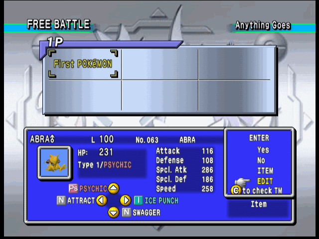
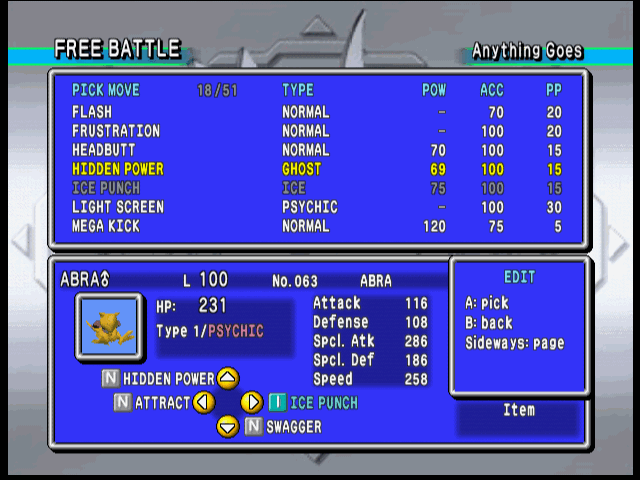
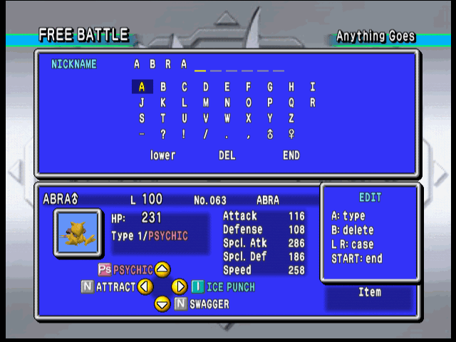

# Pokémon Stadium 2 rental editor

A patch for Pokémon Stadium 2 (USA) that adds an **EDIT** entry to the menu shown when
you pick a rental Pokémon. It opens an editor for the rental's nickname, moves, level,
DVs and Stat Exp, limited to what the Game Boy games allow, and the edited Pokémon is
what enters the battle or the registered team.

| | |
|---|---|
|  |  |
| **EDIT** joins Yes / No / ITEM on any rental. | Moves, level, DVs and Stat Exp. The game's own panel below shows the result as you go. |
|  |  |
| Every move the species can legally have, with type, power, accuracy and PP. | Nicknames, on a keyboard laid out like the Game Boy's. |

## Getting it

1. Download `stadium2-rental-editor-us.bps` from the
   [latest release](https://github.com/alex-taxiera/stadium2-rental-editor/releases/latest).
2. Apply it to your own Pokémon Stadium 2 (USA) ROM (`.z64`, SHA-1
   `d8343e69a7dc63b869cf6361d87cde64444281d3`) with any BPS patcher, such as Floating IPS
   or Rom Patcher JS.
3. In the game, go to the rental tab on any screen where Pokémon are entered, press A on
   a rental and choose **EDIT**.

The patch holds only the changes, not the game: no ROM is in this repository or in its
releases. The [user guide](../mod/README.md) has the controls, what exactly can be
changed, the known limits and a checklist for trying it on a console.
[CHANGELOG.md](../mod/CHANGELOG.md) says what each release changed.

## What can be edited

- **Moves**: any move the species or an earlier evolution learns in Red, Blue, Yellow,
  Gold, Silver or Crystal by level, TM/HM, tutor or breeding.
- **Level**, within the range of the rules in force.
- **DVs** and **Stat Exp**, with the stats recalculated as you change them. The editor
  shows what the DVs decide besides stats: gender, shininess, Unown's letter and Hidden
  Power's type and power.
- **Nickname**, up to 10 characters.

It works in Free Battle and when registering a team, for either player, with or without
an Expansion Pak, and a registered team keeps its edits. The save format is untouched.

So far it has been tested in BizHawk with its Ares64 core only, not on a console.

## This repository

This is a fork of [michiiik/pokestadiumgs](https://github.com/michiiik/pokestadiumgs),
itself a fork of [pret/pokestadiumgs](https://github.com/pret/pokestadiumgs), the
decompilation of Pokémon Stadium 2. The mod is built on it without changing its sources:

- `master` follows the decompilation. The mod is on `rental-editor`.
- [mod/](../mod) holds the mod's code, data and tests, and [tools/mod/](../tools/mod)
  its build tools.
- [mod/NOTES.md](../mod/NOTES.md) covers building, how the mod hooks the game, what was
  learned about the game along the way, the tests, and how a release is made.
- The decompilation's own README is [README.md](../README.md).

Move legality comes from Pokémon Showdown's Gen 2 learnsets and the pret Gold and Crystal
disassemblies.
