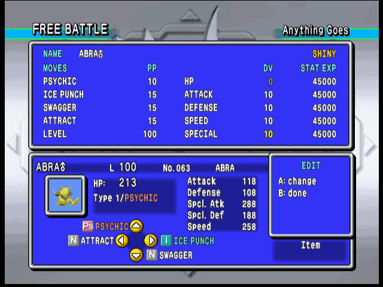
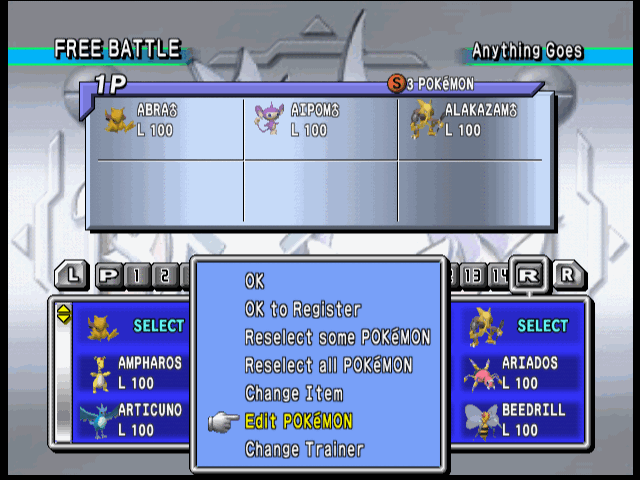
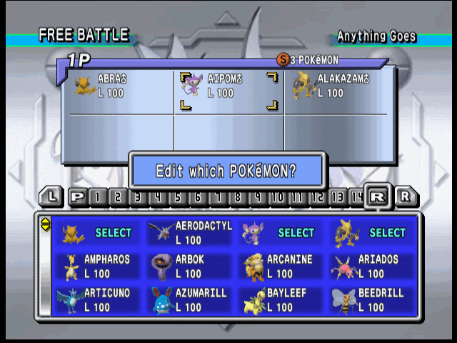
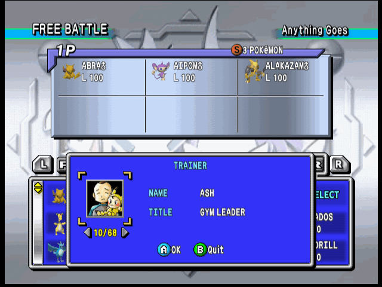

# Pokémon Stadium 2 rental editor

A patch for Pokémon Stadium 2 (USA) that adds an **EDIT** entry to the menu shown when
you pick a rental Pokémon. It opens an editor for the rental's nickname, moves, level,
happiness, DVs and Stat Exp, limited to what the Game Boy games allow, and the edited
Pokémon is what enters the battle or the registered team.

The patch is a BPS file. It contains only the changes, not the game.

## Applying the patch

You need your own Pokémon Stadium 2 (USA) ROM:

| | |
|---|---|
| Game ID | `NP3E`, revision 0 |
| Size | 64 MB (67,108,864 bytes) |
| SHA-1 | `d8343e69a7dc63b869cf6361d87cde64444281d3` |

The patch is attached to each release on this repository's Releases page.
[CHANGELOG.md](CHANGELOG.md) says what each release changed.

Apply `stadium2-rental-editor-us.bps` with any BPS patcher (Floating IPS, Rom Patcher
JS), using a `.z64` ROM. Or use the one in this repository, which also takes `.v64` and
`.n64` dumps and always writes `.z64`:

    python3 tools/mod/bps.py apply <your-rom> stadium2-rental-editor-us.bps stadium2-rental-editor.z64

A BPS patch carries checksums of the ROM it expects and of the result, so a patcher
refuses the wrong ROM and tells you if the output is wrong. `bps.py info <patch>` prints
both.

The save format is untouched. The header keeps the game ID `NP3E`, which is what ares and
most flashcart firmware use to choose the save type (Flash RAM). The header checksum does
change, so anything that looks the game up by checksum will not recognise it; set Flash
RAM by hand there.

## In the game

On any screen where Pokémon are entered (Free Battle, registering a team), go to the
rental tab (**R**), press A on a rental, and choose **EDIT** under Yes / No / ITEM. In a
two-player battle each player edits in turn with their own controller.

A rental that is already on your team can be edited where it is, without taking it off
the team and choosing it again. Once your team is chosen, Start brings up the usual menu
(OK, OK to Register, ...), which has two more entries. **Edit POKéMON** puts the cursor
in the team's box: A on a rental opens the editor on it, B closes the editor for the next
one, and B again goes back to the menu. The game's own **Reselect some POKéMON** leads to
the same place by another road: its EXCHANGE menu has **EDIT** under Yes / No. Either
way the edits are made to the Pokémon on the team, and everything changed before it was
entered is still there.

| | |
|---|---|
|  |  |

The other new entry is **Change Trainer**. It opens a window with three things to change,
Up and Down moving between them:

- your **picture**: Left and Right step through every trainer in the game. The first one
  in the ring is the game's own choice for you.
- your **name**, in place of 1P to 4P: A opens the editor's keyboard, for up to seven
  characters. An empty name gives the game's back.
- your **title**, in place of POKéMON TRAINER: Left and Right step through the forty
  titles the game gives its own trainers, GYM LEADER, RIVAL and ROCKET among them.

A on the picture or the title keeps all three and B leaves them as they were. They are
then yours on the screens before and after each battle, for every battle until the
console is switched off. Each player chooses their own, with their own controller.

The editor covers the party box; the game's own panel underneath shows the Pokémon as it
will be, with stats recalculated as you change things. The field the cursor is on has the
game's own brackets around it, which turn green while you are changing a number. The move
list has a scroll bar, and a hand points at the move the cursor is on.

| Where | Button | Does |
|---|---|---|
| Moving around | D-pad | move between moves, level, happiness, DVs and Stat Exp; Up from the top row reaches the name |
| | A | change the field under the cursor |
| | B | close the editor, back to Yes / No, or to the team's box after Edit POKéMON |
| On a number | Up / Down | one step (hold to repeat) |
| | Left / Right | a bigger step: 4 for DVs, 10 for level, 25 for happiness, 8 steps for Stat Exp |
| | L / R | lowest / highest value |
| | A or B | done |
| In the move list | Up / Down | one move (hold to repeat) |
| | Left / Right | a page |
| | A | take the move |
| | B | back without changing |
| On the keyboard | D-pad | move between keys (hold to repeat; wraps at the edges) |
| | A | type the key, or use `lower` / `UPPER`, `DEL`, `END` |
| | B | delete the last character; with none left, back without changing |
| | L or R | switch between upper and lower case |
| | Start | jump to `END` |

What can be changed:

- **Nickname**, up to 10 characters, on a keyboard laid out like the Game Boy's. It
  offers what a nickname can be typed with in Red, Blue, Yellow, Gold, Silver or Crystal:
  letters in both cases, space, `- ? ! / . ,`, `× ( ) : ; [ ]`, the PK and MN signs, and
  ♂ ♀. `END` with nothing typed gives the species name back. As in the original game, a
  nicknamed Pokémon is tinted a slightly different colour, so a rename changes how it
  looks.
- **Moves.** Any move the species or an earlier evolution learns in Red, Blue, Yellow,
  Gold, Silver or Crystal by level, TM/HM, tutor or breeding. Event-only moves are left
  out. A slot can be emptied as long as one move remains, and a move cannot be taken
  twice. PP is set to the new move's full PP.
- **Level**, within the range of the rules in force (and never below 2). The game's own
  checks on a team, such as the Poké Cup's level total, still apply when you enter it.
  For a Pokémon already on the team, the level stops where the team would go past that
  total, because the game's answer to a team past it is to have you choose its last
  Pokémon again.
- **Happiness**, 0–255, beside the level. It decides the power of Return, which grows
  with it, and of Frustration, which grows without it, each up to 102. While the cursor
  is on it the top line shows both, and the move list shows them for those two moves.
  Most rentals start at 128, which gives both moves a power of 51.
- **DVs** for Attack, Defense, Speed and Special, 0–15. The HP DV follows from the other
  four and is shown greyed.
- **Stat Exp** for all five stats, 0–65535, in the 64 steps that change the stat.
- **Held item**: use the game's own ITEM entry, as before. Its list now has every item
  the game counts as worth holding in a battle, 42 of them, where the original offers six
  berries plus whatever a connected Game Pak owns. That goes for every Pokémon on the
  screen, not only rentals. The game's own limits still apply: an item a team-mate
  already holds, or one that only works for another species, cannot be taken.

The top line of the editor shows what the DVs decide besides stats, each only when it
applies: the gender symbol, `SHINY`, Unown's letter, and Hidden Power's type and power
when the Pokémon knows the move. A rental made shiny looks shiny everywhere, battle
included.

A registered team keeps its edits. A trainer's picture, name and title are not saved:
they last until the console is switched off.

## Known limits

- An edit belongs to the Pokémon's entry in the list. If you scroll the list a long way
  before choosing Yes, the entry is rebuilt from the rental table and the edit is gone.
  Edit, then enter.
- The team's copy and the list's are two. An edit made on the team is not in the list:
  exchange that Pokémon away and choose it again, and it comes back as the list has it.
- Edit POKéMON needs the team's menu, which under rules that want a full team (the Poké
  Cup, for one) only comes up once six are chosen. Under Anything Goes, Start brings it
  up from the first.
- Outside the editor the game labels Hidden Power as Normal, as the original does.
- Moves are checked one at a time. Combinations that cannot exist on one Pokémon in the
  Game Boy games are not rejected.
- The original trainer's name and ID stay as the rental has them.
- Change Trainer has only been tried in Free Battle. A typed name shows there; the other
  modes name the player in code this does not change.
- A chosen picture is always the trainer's first expression.
- Only rentals get EDIT, not Pokémon read from a Game Pak. On a team that has both, A on
  one of the others after Edit POKéMON does nothing but sound the error; that has not
  been tried, there being no Game Pak in the tests.
- USA version only.

## What has been tested

Everything below was run in BizHawk 2.x with its Ares64 core, driven by scripts. Most of
it is now an automated suite (`mod/tests/emu`, 45 scenarios) that plays the editor and
checks the game's memory afterwards; see "Tests" in [NOTES.md](NOTES.md).

- Moves, level, happiness, DVs and Stat Exp edited and carried into a battle.
- Shiny, gender, Unown's letter and Hidden Power shown and updated as DVs change.
- Nicknames typed across both pages, special signs included; one shown in battle and
  read back byte for byte from a registered team after a console reset. The ten-character
  limit, an empty name, backing out, and the cursor wrapping at every edge.
- A registered team reloaded after a console reset with its edits intact.
- A rental edited on the team, by Edit POKéMON and by EDIT under EXCHANGE: the edits made
  before it was entered kept and added to, and all of it carried into a battle; the
  second of two edited with the first untouched; the computer's team; a second player's,
  with controller 2. Under Poké Cup rules, the level of one of the team held to 50–55 and
  stopped at the team's level total.
- Change Trainer: every picture in the window, and a chosen picture, name and title where
  the two sides are set against each other, on the order screen and on the result after
  a battle; a name taken back; a name still there on the next visit to the entry screen;
  a second player choosing theirs with controller 2; the computer's picture, name and
  title never changing; all of it gone after a power cycle.
- The ITEM list holding all 42 items, and one from beyond the original six (Leftovers)
  entered with a rental.
- EDIT from Free Battle and from Register POKéMON.
- Under Poké Cup rules the level stops at 50 and 55.
- A second player editing with controller 2, with controller 1 ignored meanwhile.
- A build made to believe the console has 4 MB of RAM (`tools/mod/make_4mb_rom.py`): the
  entry screen keeps 160 KB of its memory pool free with the mod loaded, and the editor
  and keyboard allocate nothing. (A battle on that build was run before the keyboard was
  added; the mod is unloaded by then.)
- The original ROM still builds byte for byte from the same tree, and the patch applied
  to it reproduces the modified ROM.

An earlier build has also been run on a real Nintendo 64. This build has not, so what it
adds has only been through the emulator.

Not tested: standalone ares, other emulators, the Stadium cups and Gym Leader Castle
(they use the same entry screen), and the Japanese version.

## Checklist for real hardware

1. Patch a clean ROM and copy the `.z64` to the flashcart. If the cart does not pick a
   save type by itself, it is Flash RAM, the same as the original game.
2. Boot it. The title screen and menus should be exactly as in the original.
3. Free Battle → 1P vs COM → Anything Goes → **Rental Only**. Reaching the picker means
   the mod's code was loaded.
4. A on a rental, then down to **EDIT**, A. The editor window opens over the party box.
5. Change a move, a DV, a Stat Exp value and the level. The stats in the lower panel
   follow each change.
6. Set Attack, Defense, Speed and Special DVs to 10. `SHINY` appears and the Pokémon in
   the lower panel changes colour.
7. Up to the name, A. Type a name using both cases and a sign from the bottom row, then
   Start, A. The lower panel shows the new name.
8. B, then Yes. The party box shows the Pokémon; Start, OK.
9. Pick the opponent's team and start the battle. Check the name, moves and HP in battle.
10. Leave and come back to the picker a few times, including after a battle.
11. Two players: Free Battle → 1P vs 2P. Player 2 edits with controller 2.
12. Start → **OK to Register**, switch the console off and on, and load the team from
    Registered POKéMON.
13. Repeat steps 3–9 with the Expansion Pak removed (or fitted, whichever you did not
    start with).

If something goes wrong, the useful details are the step, whether the Expansion Pak was
fitted, the flashcart and its firmware, and what was on screen: a freeze on entering the
picker points at loading the mod, a freeze on opening the Yes / No menu at the hooks, and
leftover graphics after closing the editor at the redraw.

## Building

See "Building" in [NOTES.md](NOTES.md). In short, inside WSL:

    python3 tools/mod/check_rom.py <path-to-rom>   # verify the ROM and install it as the base
    tools/mod/wsl_build.sh init                    # first time only
    tools/mod/wsl_build.sh mod                     # build/stadium2-rental-editor-us.bps

The build ends by comparing its output with `mod/checksums.txt`, which holds the SHA-1 of
the patch and of the ROM it produces. A patch you were given can be checked against the
same file.

The mod leaves the decompilation's sources untouched. Its code is one new overlay stored
in an unused part of the ROM, and eight functions of the entry screen are replaced by
jumps into it. Six more, on the screen that introduces a battle and shows its result,
have a few instructions changed in place so that they use the chosen trainer picture,
name and title. [NOTES.md](NOTES.md) has the details.

This is built on [michiiik/pokestadiumgs](https://github.com/michiiik/pokestadiumgs), a
fork of [pret/pokestadiumgs](https://github.com/pret/pokestadiumgs). Move legality comes
from Pokémon Showdown's Gen 2 learnsets and the pret Gold and Crystal disassemblies.
